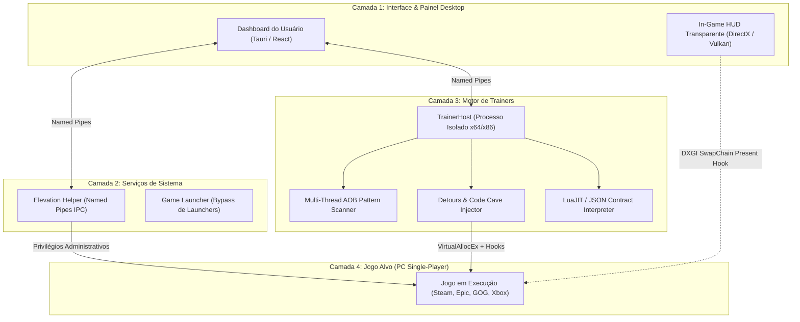

# 🧙‍♂️ Open Trainer Engine

[](https://opensource.org/licenses/MIT)
[](https://github.com/Henrique1601/open-trainer-engine/releases)
[](https://github.com/Henrique1601/open-trainer-engine)
[](docs/TRAINER_ENGINE.md)

> **Motor moderno, aberto e de alta performance para execução, criação e atualização de trainers e in-game HUD overlays para jogos single-player de PC.**  
> Projetado através da desconstrução e engenharia reversa do ecossistema WeMod (Wand Client).

---

## 💡 Sobre o Projeto

O **Open Trainer Engine** nasceu para solucionar os dois maiores problemas enfrentados pelos jogadores de PC:
1. **Jogos sem trainers nas plataformas fechadas** (jogos indie, lançamentos recentes ou títulos sem votos suficientes).
2. **Trainers desatualizados** que quebram após pequenas atualizações na Steam ou Epic Games.

Com uma arquitetura modular de 4 camadas, suporte nativo a **AOB Multi-Thread Scanning**, injeção segura por **Code Caves** e um formato de contrato aberto em **JSON + Lua**, este ecossistema permite tanto o uso fácil com um clique quanto a criação e manutenção simplificada de novos cheats pela comunidade.

---

## 🏛️ Arquitetura do Sistema



---

## 🧠 Base de Conhecimento & "Cérebro do Projeto"

Toda a documentação técnica, manuais de engenharia reversa e guias de implementação estão estruturados na pasta [`docs/`](docs/):

| Documento | Descrição |
| :--- | :--- |
| 🏛️ [**`docs/ARCHITECTURE.md`**](docs/ARCHITECTURE.md) | Detalhamento profundo das 4 camadas, IPC e protocolos de baixa latência. |
| ⚡ [**`docs/TRAINER_ENGINE.md`**](docs/TRAINER_ENGINE.md) | A máquina de estados de 14 etapas e técnicas de injeção de memória. |
| 🛠️ [**`docs/TRAINER_CREATION_GUIDE.md`**](docs/TRAINER_CREATION_GUIDE.md) | **Guia prático para criar trainers do zero** para jogos que não têm cheats. |
| 🔄 [**`docs/TRAINER_UPDATE_GUIDE.md`**](docs/TRAINER_UPDATE_GUIDE.md) | **Guia prático para atualizar trainers antigos** usando diff de binários e Ghidra. |
| 🎮 [**`docs/GAME_DETECTION.md`**](docs/GAME_DETECTION.md) | Como o sistema detecta jogos da Steam, Epic Games, GOG Galaxy e PC Game Pass. |
| 🗺️ [**`docs/ROADMAP.md`**](docs/ROADMAP.md) | Checklist e cronograma de implementação de todas as fases. |

---

## 📂 Formato Aberto de Trainers (JSON Declarativo)

Diferente de plataformas proprietárias, o Open Trainer Engine utiliza contratos declarativos legíveis por humanos:

```json
{
  "id": "hades-2",
  "title": "Hades II",
  "processName": "Hades2.exe",
  "version": "1.0.0",
  "cheats": [
    {
      "id": "god_mode",
      "name": "Modo Deus (Vida Infinita)",
      "type": "aob_patch",
      "pattern": "89 46 24 48 8B 05 ?? ?? ?? ??",
      "replace": "90 90 90 48 8B 05 ?? ?? ?? ??",
      "hotkey": "F1"
    }
  ]
}
```

Templates completos estão disponíveis em [`configs/templates/`](configs/templates/).

---

## 🚀 Como Começar

### Pré-requisitos
* **Node.js 20+** e **Rust** (para compilação do core e Tauri).
* **Git** instalado.
* **Cheat Engine / x64dbg** (opcional, para dissecação e criação de novas assinaturas AOB).

### Validação do Repositório
```bash
git clone https://github.com/Henrique1601/open-trainer-engine.git
cd open-trainer-engine
npm run validate:schema
```

---

## 🛡️ Segurança e Ética

> [!WARNING]
> **ESTRITAMENTE PARA JOGOS SINGLE-PLAYER (CAMPANHA SOLO):**  
> O Open Trainer Engine foi projetado exclusivamente para enriquecer a experiência do jogador em jogos de um jogador (offline/campanha). O software não oferece suporte, não desenvolve e rejeita qualquer tentativa de injeção em jogos multiplayer ou protegidos por sistemas anti-cheat (como Easy Anti-Cheat, BattlEye ou Vanguard). O uso indevido em modos online pode resultar em suspensão de contas pelas distribuidoras.

---

## 📄 Licença

Distribuído sob a licença **MIT**. Consulte o arquivo [`LICENSE`](LICENSE) para mais detalhes.

Copyright (c) 2026 Henrique Bezerra Dos Santos.
