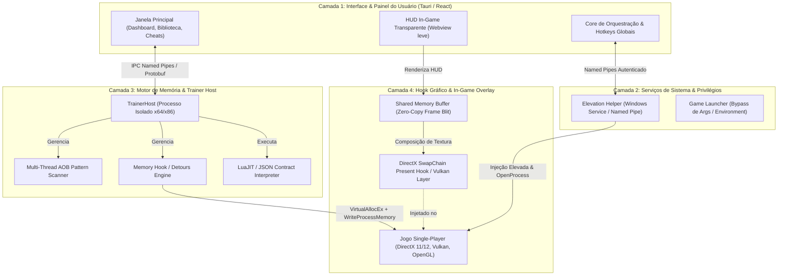

# 🏛️ Arquitetura do Sistema: Open Trainer Engine

Este documento detalha a arquitetura técnica em 4 camadas projetada a partir da engenharia reversa do cliente WeMod (codinome **Wand**), modernizada para alta performance e modularidade limpa.

---

## 📐 Visão Geral em 4 Camadas

---

## 🔍 Detalhamento das Camadas

### 1. Camada de Interface do Usuário (UI & UX)
* **Shell de Execução:** Desenvolvida em **Tauri v2 (Rust + Webview)** ou **Electron 34+**.
* **Responsabilidades:**
  * Renderizar a biblioteca de jogos detectados no computador.
  * Painel de controle de cheats com sliders (velocidade, dinheiro), toggles (vida infinita, estamina) e remapeamento de teclas de atalho (Numpad, combinações de teclado e controle Xbox/DualSense).
  * Comunicação em tempo real com o motor de cheats sem travar a interface gráfica.

### 2. Camada de Elevação de Privilégios (System Elevation Helper)
* **Objetivo:** Jogos executados como Administrador bloqueiam chamadas normais de `OpenProcess` vindas de processos sem privilégios.
* **Mecanismo:**
  * Um helper ou serviço Windows leve com privilégios de Administrador.
  * Comunica-se exclusivamente via **Named Pipes locais** (`\\.\pipe\OpenTrainerAuxiliary`) com validação de token local.
  * Realiza `InjectDll`, leitura de processos protegidos e inicialização de executáveis com argumentos avançados.

### 3. Camada do Motor de Memória (Trainer Host & Scanner)
* **Isolamento de Processo:**
  * O motor de cheats roda em um processo separado (`TrainerHost_x64.exe` ou `TrainerHost_x86.exe`).
  * **Vantagem crítica:** Se o jogo crashar ou um ponteiro inválido causar um `AccessViolationException`, apenas o host do trainer encerra; a interface do usuário permanece 100% intacta.
* **Submódulos do Motor:**
  * **AOB Scanner:** Varre a memória virtual do processo alvo procurando assinaturas com máscaras binárias em múltiplos núcleos de CPU.
  * **Pointer Resolver:** Resolve cadeias multinível de ponteiros com offsets dinâmicos (`[[[base + off1] + off2] + off3]`).
  * **Code Detour Hook:** Aloca páginas de memória executável (`PAGE_EXECUTE_READWRITE`) no processo do jogo e cria saltos (`jmp`) para interceptar instruções do jogo antes que elas subtraiam vida ou consumam munição.
  * **Scripting Engine:** Interpretador Lua leve (LuaJIT) para mecânicas de jogos que exigem lógica condicional avançada (ex: teleportar para coordenadas, multiplicar experiência).

### 4. Camada de Overlay In-Game (DirectX & Vulkan HUD)
* **Hook Gráfico:**
  * Intercepta a chamada `IDXGISwapChain::Present` no DirectX 11 e DirectX 12.
  * Em jogos Vulkan, atua como uma **Vulkan Layer** oficial registrada no Windows Registry.
* **Renderização Zero-Lag:**
  * O menu do HUD (desenhado via HTML/CSS ou Dear ImGui) é projetado diretamente sobre o frame do jogo antes do envio à tela.
  * O jogo não perde foco de janela e a taxa de quadros (FPS) permanece inalterada.
