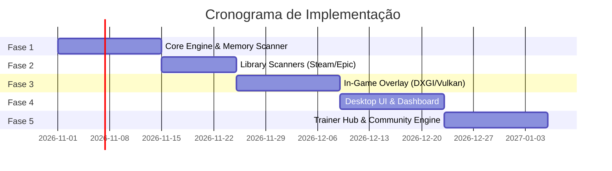

# 🗺️ Roadmap de Implementação: Open Trainer Engine

Este roadmap estabelece o plano sequencial de desenvolvimento para a reconstrução do aplicativo e motor de trainers.

---

## 🎯 Fases de Execução

---

### Fase 1: Motor de Memória de Baixo Nível (Core Engine)
- [ ] Implementar classe de abstração de processos (`ProcessHandle`, `ReadProcessMemory`, `WriteProcessMemory`).
- [ ] Implementar algoritmo multi-thread de busca de assinaturas AOB com máscaras (`??`).
- [ ] Implementar resolução de cadeias de ponteiros com offsets dinâmicos.
- [ ] Implementar alocação de Code Cave remota (`VirtualAllocEx`, `PAGE_EXECUTE_READWRITE`).
- [ ] Criar processo worker isolado `TrainerHost` com comunicação via Named Pipe.

### Fase 2: Módulo de Detecção Automática de Bibliotecas
- [ ] Parser de arquivos VDF da Steam (`libraryfolders.vdf` e `appmanifest_*.acf`).
- [ ] Scanner de manifestos JSON da Epic Games (`%ProgramData%\Epic\EpicGamesLauncher\Data\Manifests`).
- [ ] Leitor de chaves de registro do GOG Galaxy e Ubisoft Connect.
- [ ] Detector de jogos do PC Game Pass via WinRT `PackageManager`.
- [ ] Suporte para adição manual de executáveis locais (Standalone / Custom).

### Fase 3: In-Game HUD & Overlay Gráfico
- [ ] Criação da DLL de hook gráfico (`overlay_hook.dll`).
- [ ] Implementação de hook na cadeia de apresentação `IDXGISwapChain::Present` (DirectX 11 e DirectX 12).
- [ ] Suporte à camada oficial Vulkan Layer no registro do Windows.
- [ ] Criação de memória compartilhada (`Shared Memory`) para transferência de texturas do HUD.
- [ ] Hook global de teclas de atalho (`WH_KEYBOARD_LL` ou `RegisterHotKey`).

### Fase 4: Interface Desktop (Dashboard & UX)
- [ ] Setup do projeto em **Tauri v2** com React 19, Tailwind CSS e componentes shadcn/ui.
- [ ] Grid de jogos instalados com capa em alta resolução (via SteamGridDB API).
- [ ] Tela de controle de cheats com botões de toggle, sliders numéricos e remapeamento de teclas.
- [ ] Sistema de notificações sonoras e visuais ao ligar/desligar cheats.

### Fase 5: Hub de Criação & Atualização de Trainers
- [ ] Implementação do leitor de contratos JSON declarativos de cheats.
- [ ] Interpretador de scripts Lua integrado ao motor do trainer (via LuaJIT).
- [ ] Ferramenta gráfica embutida para criar novos cheats sem sair do app (Scanner de memória básico).
- [ ] Sistema de detecção de versão e alerta de compatibilidade com suporte a múltiplos hashes de `.exe`.
