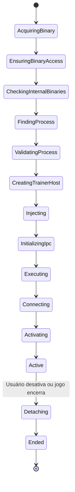

# ⚡ Motor de Execução de Trainers (Trainer Engine)

O motor de trainer é o núcleo de baixo nível responsável por encontrar, manipular e travar valores dentro da memória do jogo em execução.

---

## 🔄 A Máquina de Estados do Trainer (14 Fases)

Para garantir máxima estabilidade e evitar crashes acidentais, a execução de qualquer cheat deve seguir rigorosamente o ciclo de vida abaixo:



### Explicação das Fases:
1. **AcquiringBinary:** Baixa ou carrega o manifesto JSON/Lua do trainer.
2. **EnsuringBinaryAccess:** Garante que antivírus e Windows Defender não bloquearam as DLLs auxiliares.
3. **CheckingInternalBinaries:** Checa se o injetor e os plugins estão íntegros.
4. **FindingProcess:** Localiza o processo pelo nome do executável (ex: `Hades2.exe`).
5. **ValidatingProcess:** Checa se a arquitetura é x86 ou x64 e se a versão confere.
6. **CreatingTrainerHost:** Spawna o processo isolado `TrainerHost` com o PID do jogo.
7. **Injecting:** Injeta os hooks necessários caso o mod use DLL Injection.
8. **InitializingIpc:** Abre o canal de Named Pipe para troca de mensagens.
9. **Executing:** Carrega as tabelas de AOB e scripts na memória.
10. **Connecting:** Confirma sincronização entre o Host e a UI.
11. **Activating:** Aplica os patches de ativação inicial.
12. **Active:** Estado estável de operação (recebe atalhos e cliques de toggles).
13. **Detaching:** Restaura os bytes originais da memória do jogo antes de finalizar (limpeza limpa).
14. **Ended:** Processo host é finalizado sem deixar rastros na memória do sistema operacional.

---

## 🧩 Modos de Manipulação de Memória

### 1. Patch de Instrução Direta (NOPing)
Usado para coisas simples, como munição infinita ou vida que não diminui:
* **Instrução original do jogo:**
  ```assembly
  sub [rax+0x18], ecx   ; subtrai dano da vida
  ```
* **Bytes originais:** `29 48 18`
* **Bytes do patch (NOP):** `90 90 90` (instrução é ignorada, vida nunca cai).

### 2. Code Cave / Detour Hook (Injeção de Código Dinâmica)
Usado quando é necessário lógica condicional (ex: "Modo Deus só para o jogador, não para os inimigos"):
* O motor aloca memória remota com `VirtualAllocEx(hProcess, NULL, 1024, MEM_COMMIT, PAGE_EXECUTE_READWRITE)`.
* Substitui a instrução do jogo por um `jmp` até a memória alocada:
  ```assembly
  ; Código Injetado (Code Cave)
  cmp [rax+0x10], 1       ; Verifica se quem tomou dano é o Jogador (ID = 1)
  jne ApplyDamage         ; Se for inimigo, toma dano normal
  mov ecx, 0              ; Se for o jogador, zera o dano
  ApplyDamage:
  sub [rax+0x18], ecx     ; Executa o dano
  jmp ReturnAddress       ; Volta para o fluxo normal do jogo
  ```

### 3. Congelamento de Valores (Value Freezing)
* O motor cria uma thread leve que reescreve periodicamente o valor em um endereço ou ponteiro (ex: travar dinheiro em 999.999 a cada 100ms).
