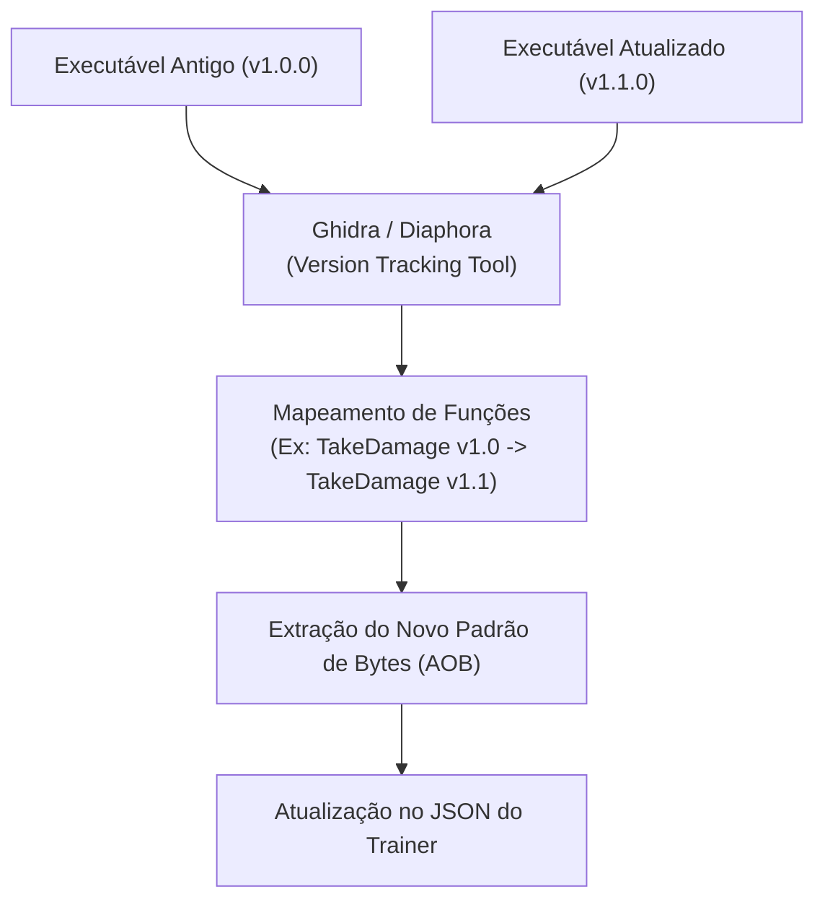

# 🔄 Guia de Atualização de Trainers (Pós-Patch do Jogo)

Quando um jogo é atualizado na Steam, Epic ou Game Pass, o binário executável muda e instruções de código podem ser deslocadas. Este guia descreve como diagnosticar e atualizar um trainer que parou de funcionar.

---

## 🔍 Passo 1: Diagnóstico do Erro

Ao rodar um trainer antigo em uma versão nova do jogo, o motor de execução retornará um dos seguintes estados:

| Erro Retornado | Causa Real | Solução |
| :--- | :--- | :--- |
| **`AOB Pattern Not Found`** | A instrução ou os bytes ao redor foram alterados pelo compilador do jogo. | O padrão de bytes (AOB) precisa ser re-escaneado ou ajustado. |
| **`Pointer Chain Broken`** | Um dos offsets intermediários do ponteiro mudou de lugar na estrutura da classe. | Re-escanear a cadeia de ponteiros no Cheat Engine (*Pointer Scan*). |
| **`Access Violation / Crash`** | A função foi modificada e a quantidade de parâmetros/registradores mudou. | Ajustar o hook de assembly para respeitar a nova convenção de chamada (calling convention). |

---

## 🛠️ Passo 2: Técnica 1 — Busca de Assinatura Reduzida (Fast-Fix)

Muitas vezes, a assinatura falha porque uma instrução irrelevante no contexto mudou de offset.

1. **Assinatura Original (Falhou):**
   ```text
   48 8B 81 28 01 00 00 48 85 C0 74 12 48 8B 48 10
   ```
2. **Procedimento:**
   * Reduza o tamanho da busca mantendo apenas os bytes essenciais da instrução alvo e preencha as referências relativas com wildcards (`??`):
   ```text
   48 8B ?? ?? ?? ?? ?? 48 85 C0 74 ?? 48 8B
   ```
3. Se a busca retornar **1 único resultado** na memória do executável atualizado, a nova assinatura é válida e o cheat volta a funcionar imediatamente.

---

## 🧬 Passo 3: Técnica 2 — Diffing de Binários (Comparação de Executáveis)

Se o código mudou substancialmente e a assinatura não é mais encontrada, use a técnica de **Binary Diffing**:



### Procedimento com Ghidra:
1. Abra o **Ghidra** (ferramenta gratuita de engenharia reversa).
2. Carregue o executável da versão antiga (ou consulte o endereço onde o AOB antigo batia).
3. Use o assistente de **Version Tracking** contra o novo executável do jogo.
4. O Ghidra identificará a mesma função através do grafo de controle de fluxo e semântica de código.
5. Copie os novos bytes da instrução e atualize o `pattern` no arquivo do trainer.

---

## 🏷️ Passo 4: Registro de Múltiplas Versões no Manifesto

Para que seu app suporte tanto quem está na versão mais nova quanto quem não atualizou o jogo ainda, estruture o manifesto com variantes de versão:

```json
{
  "id": "game-example",
  "versions": [
    {
      "version": "1.2.0",
      "buildId": "12345678",
      "executableHash": "a1b2c3d4...",
      "cheats": [
        {
          "id": "god_mode",
          "pattern": "48 89 5C 24 08 57 48 83 EC 20",
          "replace": "90 90 90 90 90 57 48 83 EC 20"
        }
      ]
    },
    {
      "version": "1.0.0",
      "buildId": "10000000",
      "executableHash": "f5e4d3c2...",
      "cheats": [
        {
          "id": "god_mode",
          "pattern": "48 89 5C 24 10 57 48 83 EC 30",
          "replace": "90 90 90 90 90 57 48 83 EC 30"
        }
      ]
    }
  ]
}
```
O motor do seu app seleciona automaticamente a versão correta comparando o hash ou a versão do arquivo `.exe` antes de injetar!
